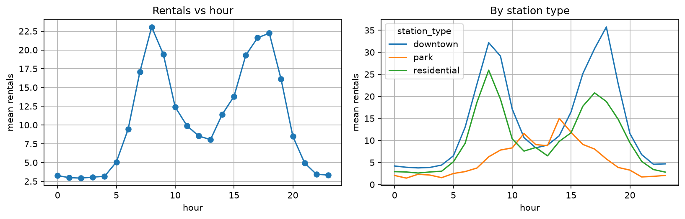
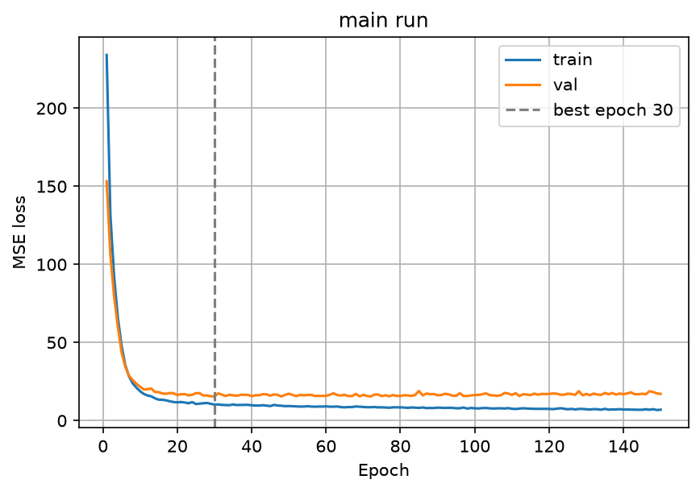
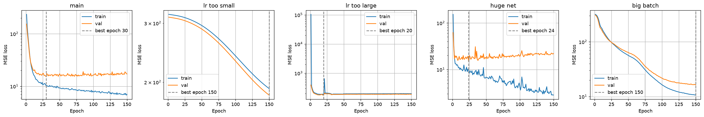
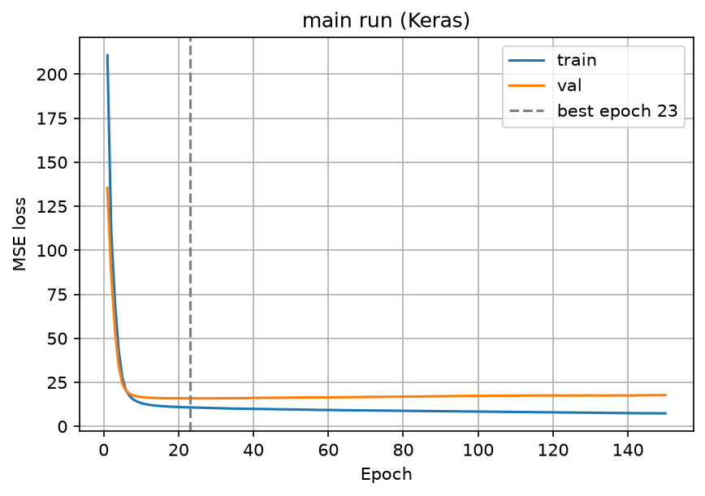

# Lakeshore Bike Demand: the same model in PyTorch and Keras

## What it does

Predicts how many bikes will be rented from a Lakeshore Bike Share station in the coming hour, from the hour of the day, the weather, whether it is a weekend and the type of station. A small neural network, with the training loop written by hand in PyTorch, is compared honestly with two simple baselines: predicting the training mean and a linear regression. The same network is then built a second time in Keras, checked to be the same function, trained with the same settings on the same rows, and the two frameworks are compared over three seeds ([COMPARISON.md](COMPARISON.md)).

## How to run it

```
conda env create -f environment.yml
conda activate lab08-same-model-twice
python train.py
python train_keras.py
python compare.py
python -m ruff format --check .
python -m ruff check .
python -m pytest
```

`python train.py` recreates everything in `reports/`: `learning_curves.png`, `experiment_curves.png`, `rentals_vs_hour.png`, `history.csv`, `experiments.csv` and `metrics.json`. The run takes about a minute on a laptop CPU.

`python train_keras.py` trains the Keras version of the main run and writes `history_keras.csv`, `learning_curves_keras.png` and `metrics_keras.json` (about 10 seconds). `python compare.py` checks that the two networks compute the same function, trains both frameworks on seeds 2026, 7 and 42 and writes `comparison.csv` (about a minute, six models).

The Keras checkpoints saved by `ModelCheckpoint` (`checkpoints/*.keras`, about 100 KB each) are binary files and are **not committed**: `.gitignore` excludes them, and both scripts recreate them.

## Data and split

`bikes_data.py` (given, not edited) builds 6,000 station-hours from a seed. The table is split once, before any preparation, into 60% training (3,600 rows), 20% validation (1,200) and 20% test (1,200) with a fixed seed (`random_state=2026`).

Preparation is fitted on the training rows only and then applied to validation and test:

- `temperature_c`, `rain_mm` and `wind_kph` are standardized with `StandardScaler`.
- `station_type` and `hour` are one-hot encoded (3 + 24 columns). The effect of the hour is not monotonic (two commute peaks), so a single number would be hard for the network to use.
- `is_weekend` is passed through.

This gives 31 float32 features per row. Fitting the scaler on all rows would leak the mean and spread of the validation and test rows into training, so a test checks that the training features average zero while the validation features do not.



The average number of rentals rises and falls twice during the day (peaks around 08:00 and 17:00-18:00) and differs strongly between station types, with parks peaking around midday. A straight line in the hour cannot describe this, which matters for the linear baseline below.

## Model and training

- **Network:** `RentalModel` in `model.py`: 31 inputs, two hidden layers of 64 units with ReLU, one output with no activation, because the target is a count and not a probability.
- **Loss and optimizer:** mean squared error, Adam with learning rate 0.003.
- **Batches:** 64 rows, training batches shuffled, validation and test batches in order.
- **Epochs:** 150. After every epoch the training loss, the validation loss and the validation MAE (in rentals) are logged to `reports/history.csv`, and the weights of the epoch with the lowest validation loss are put back at the end.
- **Loop:** written by hand in `train.py` (`run_epoch` and `fit`); `optimizer.zero_grad()`, `loss.backward()` and `optimizer.step()` are visible there.
- **Seeds:** `random_state=2026` for the split, `torch.manual_seed(2026)` before every model and a seeded generator for the training `DataLoader`. Two runs of `python train.py` on the same computer give identical numbers; on another computer they may differ in the last digits.
- **Device:** CPU. On this small problem a GPU was slower than the CPU in a timing check.

## Results

Errors are in rentals per station-hour. The network row uses the weights of the best validation epoch (epoch 30), and the test rows were evaluated once, at the end.

| Model | Validation MAE | Test MAE | Validation RMSE | Test RMSE |
|---|---|---|---|---|
| Training mean | 9.71 | 9.75 | 13.98 | 13.64 |
| Linear regression | 7.61 | 7.74 | 11.11 | 11.01 |
| Network (main run) | **2.65** | **2.41** | **3.93** | **3.62** |

The linear model does little better than the mean because the relationship is not a straight line: the effect of the hour has two peaks and depends on the station type and on weekdays against weekends, and rentals fall off with temperature on both sides of a comfortable value. A model that adds up one effect per feature cannot express these interactions, while the network with two hidden layers can.



Both losses fall quickly in the first 20 epochs. The validation loss then stays flat at about 16 while the training loss keeps falling to about 7, and the validation loss creeps up slightly after the best epoch (30): the network starts to memorize the training rows, so the saved weights are the ones from the best epoch and not the last one.

## Experiments

Each run changes one thing from the main run and keeps everything else, including the seed, the same.

| Run | Hidden units | Layers | Learning rate | Batch | Best epoch | Best val MAE | Final train loss | Final val loss |
|---|---|---|---|---|---|---|---|---|
| main | 64 | 2 | 0.003 | 64 | 30 | 2.649 | 6.988 | 17.131 |
| lr too small | 64 | 2 | 0.00001 | 64 | 150 | 8.486 | 191.384 | 182.951 |
| lr too large | 64 | 2 | 1.0 | 64 | 20 | 9.134 | 196.660 | 187.492 |
| huge net | 512 | 3 | 0.003 | 64 | 24 | 2.595 | 2.838 | 22.037 |
| big batch | 64 | 2 | 0.003 | 1024 | 150 | 2.693 | 10.621 | 16.413 |



- **main: fine.** Both curves fall and flatten, and the gap between them is moderate. The validation loss turns up only slightly after epoch 30, so training could stop there.
- **lr too small: underfitting.** After 150 epochs both losses are still near 190 and still falling smoothly; the network has barely moved, and the best epoch is simply the last. It would need far more epochs.
- **lr too large: unstable.** The training loss starts at about 100,000, then jumps around between 100 and 200 without settling. Both losses stay high and noisy, and the best validation MAE (9.1) is no better than predicting the mean.
- **huge net: overfitting.** The training loss keeps falling to about 3, but the validation loss stops improving after the first few epochs and drifts up to about 21. The best epoch is 24; the large gap between the curves is the sign of memorizing the training rows. Its best validation MAE (2.60) is close to the main run, so the extra capacity buys nothing.
- **big batch: slow, still underfitting at the end.** With 1,024 rows per batch there are only 4 updates per epoch, so the curves are smooth but still falling at epoch 150 (best epoch 150), and the final losses are higher than the main run's best.

## The Keras version

- **Network:** `build_keras_model` in `keras_model.py` builds a `keras.Sequential` with the same layers as `RentalModel`: 31 inputs, `n_hidden` Dense layers of `hidden` units with ReLU and one Dense output with no activation. Both sizes are arguments, as in PyTorch, and the parameter count is the same (6,273 for the main run; a test checks four sizes).
- **Same rows:** `train_keras.py` takes the arrays from `prepare.prepare()`, the same ones the PyTorch `Dataset` is built from; nothing is prepared a second time.
- **Training:** `compile` with mean squared error, Adam at 0.003 and MAE as a metric, then `fit` with batch size 64, 150 epochs and `keras.utils.set_random_seed(2026)`. `EarlyStopping(restore_best_weights=True)` has a patience of 150, so it never stops early and both versions train for the same length; it only puts back the best epoch, as `fit` does by hand in `train.py`. `ModelCheckpoint` saves the best model to `checkpoints/rental_keras.keras`. Training loss, validation loss and validation MAE are logged per epoch to `reports/history_keras.csv`.
- **Equivalence check:** `copy_torch_to_keras` copies every `nn.Linear` into the matching `Dense` layer, transposing each weight, because PyTorch stores (outputs, inputs) and Keras (inputs, outputs). With the same weights the two networks' predictions on the 1,200 validation rows differ by at most **4.3e-08**, which is float32 rounding; `compare.py` stops if the gap is above 1e-5.



The Keras curves have the same shape as the PyTorch ones: a fast fall, a flat validation loss near 16 and a slow rise after the best epoch (23). The best epoch differs because the two frameworks start from different initial weights (Glorot uniform and zero biases in Keras) and shuffle the batches differently.

Main configuration, three seeds (`reports/comparison.csv`; the test rows were scored once per model):

| Framework | Seed | Best epoch | Val MAE | Test MAE | Seconds |
|---|---|---|---|---|---|
| PyTorch | 2026 | 30 | 2.649 | 2.438 | 5.3 |
| Keras | 2026 | 23 | 2.660 | 2.371 | 9.9 |
| PyTorch | 7 | 34 | 2.594 | 2.406 | 4.7 |
| Keras | 7 | 37 | 2.649 | 2.369 | 9.9 |
| PyTorch | 42 | 50 | 2.633 | 2.414 | 4.6 |
| Keras | 42 | 16 | 2.629 | 2.447 | 10.0 |

Mean test MAE is 2.42 for PyTorch and 2.40 for Keras; the difference is smaller than the spread between seeds, so the frameworks tie on accuracy. PyTorch trained about twice as fast (4.9 s against 9.9 s per run). The written comparison and the recommendation are in [COMPARISON.md](COMPARISON.md).

## Tests

`python -m pytest` runs 30 tests. The 16 from Lab 07 cover the split and preparation, the PyTorch network and the training loop. The 14 in `tests/test_keras.py` check that the Keras network returns one value per row; that its parameter count equals the PyTorch network's for four sizes (parametrized); that copied weights give the same predictions, and that a copy without the transpose is caught (square layers, so it would load without a shape error); that both frameworks receive identical arrays; that Keras memorizes one batch of 32 rows; that a saved and reloaded `.keras` model predicts the same; that the restored model scores the best epoch's validation loss and not the last one; that the same seed repeats a short run; and that `compare.py` writes a table with the required columns.

## Limitations

- The data are invented: they come from a formula plus random counts and represent no real station, city or season. Results say how well the method works on this table, not how many bikes a real station will lose.
- The table has no information about holidays, events, school terms, bike availability or station capacity. Rentals are counted only when a bike was there to rent, so the model predicts rentals, not true demand.
- It sees only the current hour. It does not know the previous hours' rentals, tomorrow's forecast or the trend of the week.
- The typical error is about 2.4 bikes per station-hour on the test rows, but errors are larger at busy hours, and the counts have a long tail (up to 105 in a single hour); a planner should not rely on single predictions for peak hours at busy stations.
- It should not be used for real staffing or rebalancing decisions without real data, a time-based split and a new evaluation on later weeks.
- The test rows were used once, for the number in the Results table.
- The framework comparison uses one small tabular network, three seeds and one laptop CPU (Apple M-series). Timings on a bigger model or a GPU may be different.
